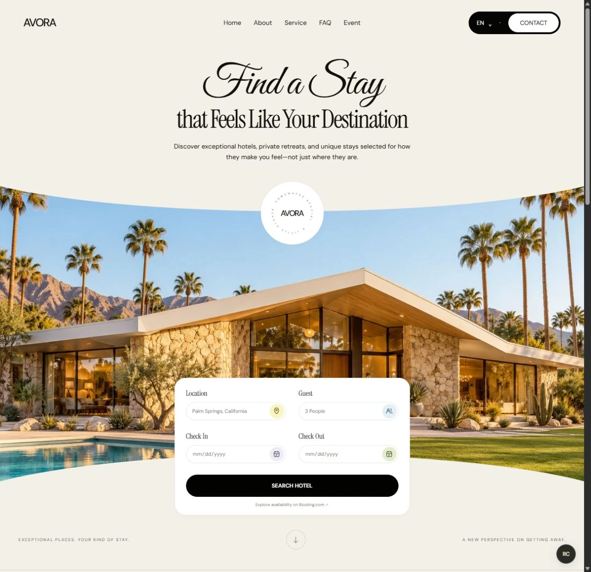

# Avora

A standalone Next.js App Router website with TypeScript, responsive CSS, original generated architectural imagery, curved hero framing, a rotating SVG seal, and Great Vibes, Instrument Serif, and DM Sans typography.

## Run

npm install
npm run dev

Open http://localhost:3000. Production build: npm run build. Type check: npx tsc --noEmit.

## Scope

Home, About, Service, FAQ, and Event sections. Validated hotel search opens real Booking.com results in a new tab. Contact links to booking support. No proprietary hotel inventory, database, authentication, or reservation backend is claimed or required. The brand and imagery were created for this design.

Original asset: public/images/avora-villa.webp. Icons and seal are code-native SVG. Fonts are bundled at build time with Next.js Font.
